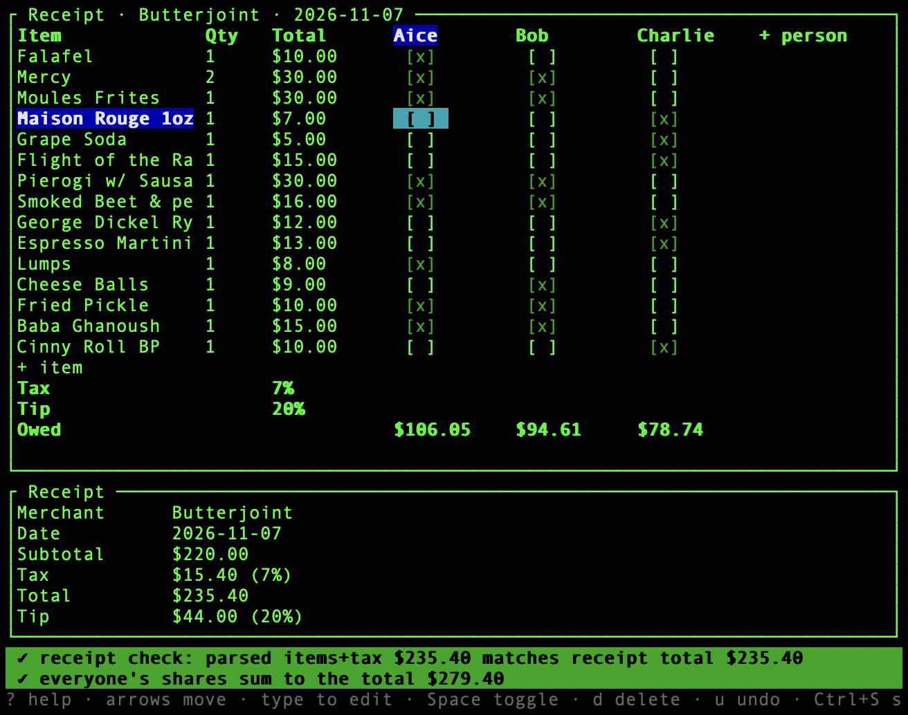

# Split Expenses Tool



`split` is a TUI application for dividing restaurant bills. It leverages `pi` to OCR receipt images, populating line items automatically. People are added as columns to a grid for quick assignment of shared items.

The tool automates total calculation, including proportional allocation of tax and tip, and employs largest-remainder rounding to ensure exact cent-for-cent matching.

### Features
- **OCR Extraction**: Automatic parsing of receipt images via `pi`.
- **Spreadsheet Interface**: Grid-based editing for items, quantities, and totals.
- **Real-time Reconciliation**: Verification that item totals match the receipt and allocations match the final bill.
- **Direct Interaction**: Arrow-key navigation and type-to-edit input.
- **Automatic Persistence**: State is saved and reloaded based on image content hash.

### Quick Start
```sh
cargo run --release -- receipt.jpg
```

---
*Requires `pi` and a vision-capable model.*
